# Adria — Plateforme bancaire en microservices

Application bancaire avec gestion des comptes, paiements, virements et assistant conversationnel. Le backend Spring Boot expose des API REST, GraphQL et des outils MCP ; le frontend Angular permet d'utiliser les services depuis une interface commune. L'assistant Spring AI utilise Ollama et peut aussi répondre via Telegram.

Ce README présente le projet et les **19 captures extraites du document `Untitled 1.odt`**. Les captures illustrent différents moments de la démonstration : les soldes peuvent donc varier d'une image à l'autre.

## Sommaire

- [Architecture](#architecture)
- [Démarrage](#démarrage)
- [Interface Angular](#interface-angular)
- [API des comptes et transactions](#api-des-comptes-et-transactions)
- [Découverte, configuration et routage](#découverte-configuration-et-routage)
- [Assistant IA et Telegram](#assistant-ia-et-telegram)
- [Tests et livraison](#tests-et-livraison)

## Architecture

| Module | Rôle | Port local |
| --- | --- | --- |
| `discovery-service` | Annuaire Eureka pour la découverte des services | `8761` |
| `config-service` | Configuration centralisée avec Spring Cloud Config, profil `native` | `8888` |
| `account-service` | Comptes, soldes, statuts, crédit et débit ; REST, GraphQL et MCP | `8081` |
| `transaction-service` | Paiements, historique, virements et contrôle du plafond ; REST, GraphQL et MCP | `8082` |
| `ai-agent-service` | Assistant Spring AI, client MCP, Ollama et bot Telegram | `8083` |
| `gateway-service` | Point d'entrée HTTP et routage par découverte Eureka | `9999` |
| `frontend-angular` | Tableau de bord et opérations bancaires | `4200` en développement, `8080` avec Docker |

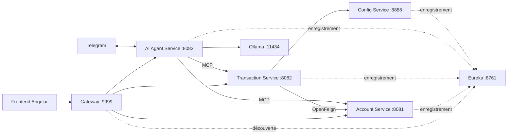

Le projet Maven regroupe six services Java. Le client Angular se trouve dans un répertoire distinct.

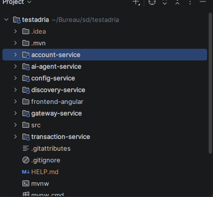

**Technologies déclarées dans le projet :** Java 21, Spring Boot 4.1.2, Spring Cloud 2025.1.4, Spring AI 2.0.2, Angular 21.2, Spring Data JPA, H2, OpenFeign et Resilience4j. Docker Compose orchestre les conteneurs et GitHub Actions définit la compilation, les tests et la publication des images.

## Démarrage

### Avec Docker Compose

Prérequis : Docker et le plugin Docker Compose. Pour utiliser l'assistant, démarrer également Ollama sur la machine hôte avec un modèle accessible.

```bash
git clone https://github.com/ahmed-douyry/DOUYRY_AHMED_test_ENSET_2026.git
cd DOUYRY_AHMED_test_ENSET_2026
docker compose up -d --build
docker compose ps
```

Ouvrir l'application sur **http://localhost:8080** et Eureka sur **http://localhost:8761**. Les sondes de disponibilité permettent à Compose d'attendre le démarrage des services dépendants.

Une fois la pile démarrée, Docker Desktop affiche le groupe `adria` et les sept conteneurs au statut running : découverte (`8761`), configuration (`8888`), comptes (`8081`), transactions (`8082`), agent IA (`8083`), gateway (`9999`) et frontend (`8080`).

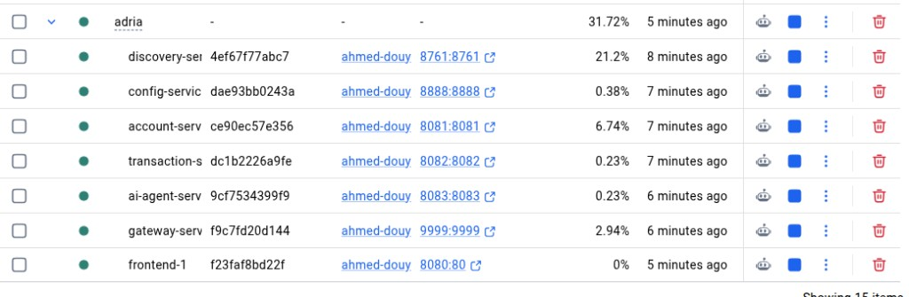

Variables facultatives à définir dans l'environnement ou dans un fichier `.env` local :

```dotenv
OLLAMA_BASE_URL=http://host.docker.internal:11434
OLLAMA_MODEL=gpt-oss:120b-cloud
TELEGRAM_BOT_TOKEN=
```

Le modèle indiqué est la valeur par défaut du projet. Adapter `OLLAMA_MODEL` au modèle disponible dans votre installation Ollama ; un modèle cloud peut nécessiter une connexion au compte du fournisseur. Sans jeton Telegram, le bot reste désactivé.

```bash
# Consulter les journaux
docker compose logs -f

# Arrêter la pile
docker compose down
```

Les bases H2 des comptes et des transactions sont en mémoire : les données ne sont pas conservées après le redémarrage de ces services.

### En développement local

Prérequis : JDK 21 et Node.js 22.12 ou supérieur dans la série 22, avec npm. Le wrapper Maven est fourni.

```bash
./mvnw -B -ntp -DskipTests package
```

Lancer chaque commande dans un terminal distinct, depuis la racine du projet, en respectant cet ordre :

```bash
./mvnw -pl discovery-service spring-boot:run
./mvnw -pl config-service spring-boot:run
./mvnw -pl account-service spring-boot:run
./mvnw -pl transaction-service spring-boot:run
./mvnw -pl ai-agent-service spring-boot:run
./mvnw -pl gateway-service spring-boot:run
```

Attendre la disponibilité des comptes et des transactions avant de lancer l'agent IA. Ollama doit être accessible à `http://localhost:11434`, ou à l'adresse définie par `OLLAMA_BASE_URL`.

Pour démarrer le frontend :

```bash
cd frontend-angular
npm ci
npm start
```

Ouvrir **http://localhost:4200**. Le proxy Angular redirige `/account`, `/transaction` et `/agent` vers la gateway locale sur le port `9999`.

## Interface Angular

### Tableau de bord

Le tableau de bord présente les encours par devise, le nombre de comptes, les comptes actifs ou bloqués et les derniers mouvements. La capture montre cinq comptes, dont quatre actifs et un bloqué, ainsi qu'un plafond d'opération de `1000`.

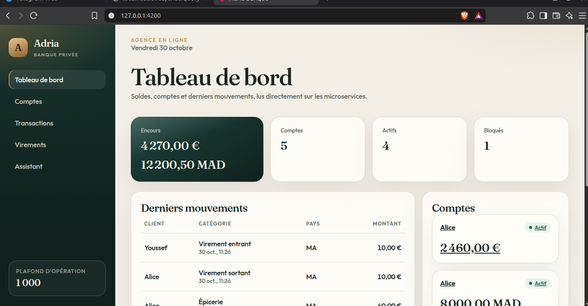

### Gestion des comptes

L'écran des comptes affiche le client, le solde et le statut. Le panneau du compte sélectionné propose le crédit, le débit et le blocage. Dans cette capture, le compte EUR d'Alice est sélectionné avec un solde de `2 460,00 €`.

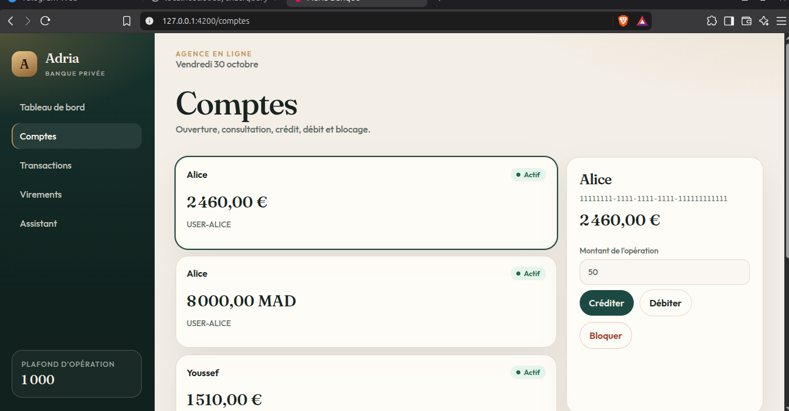

### Paiements et historique

La page des transactions réunit un journal filtrable par compte et un formulaire de paiement : compte à débiter, montant, devise, catégorie et pays.

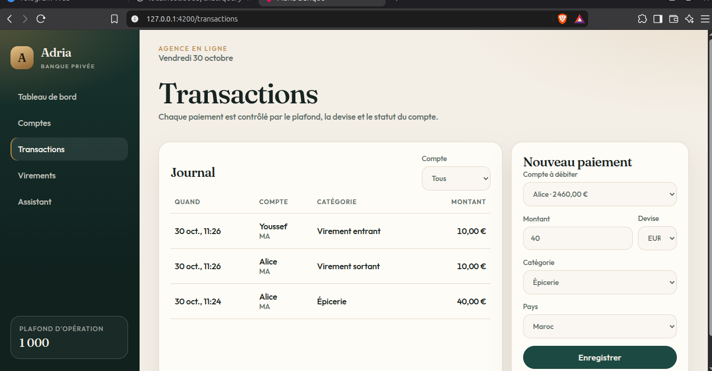

### Virements

Le formulaire permet de sélectionner le compte source, le destinataire, le montant, la devise et le pays. La capture présente la préparation d'un virement de `100 EUR` d'Alice vers Youssef ; elle ne montre pas sa confirmation.

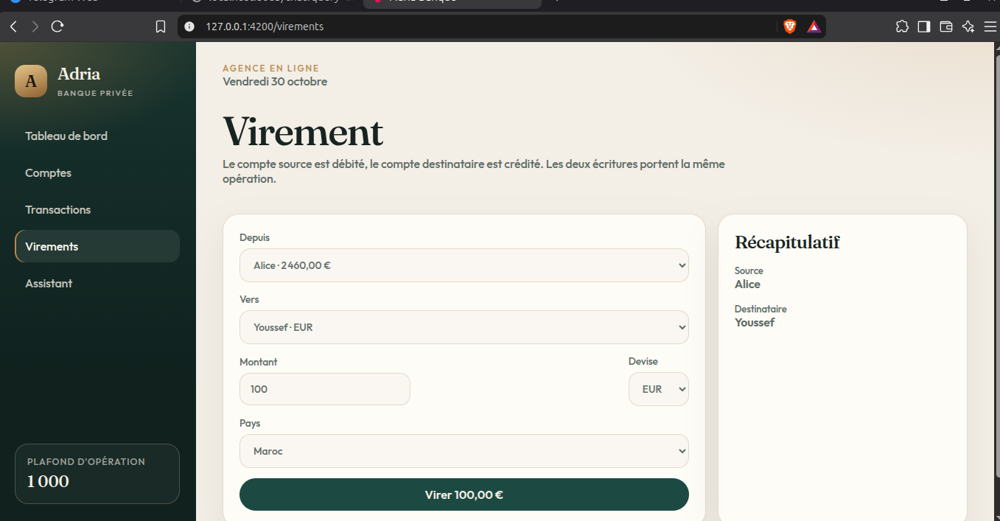

### Assistant dans l'application

L'utilisateur peut demander la liste des comptes, un solde ou les dernières transactions en langage naturel. La capture montre une réponse listant les comptes, puis une réponse concernant le solde EUR d'Alice.

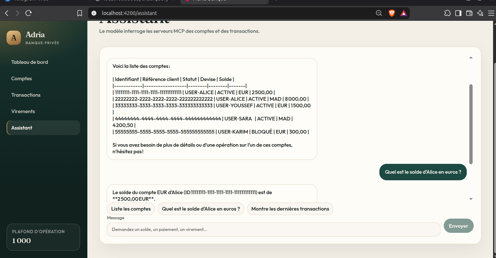

## API des comptes et transactions

### Service des comptes et outils MCP

Le contrôleur REST du service des comptes délègue les opérations à `AccountService`. La capture montre notamment la création d'un compte avec une réponse HTTP `201 Created` et une adresse de ressource dans l'en-tête `Location`.

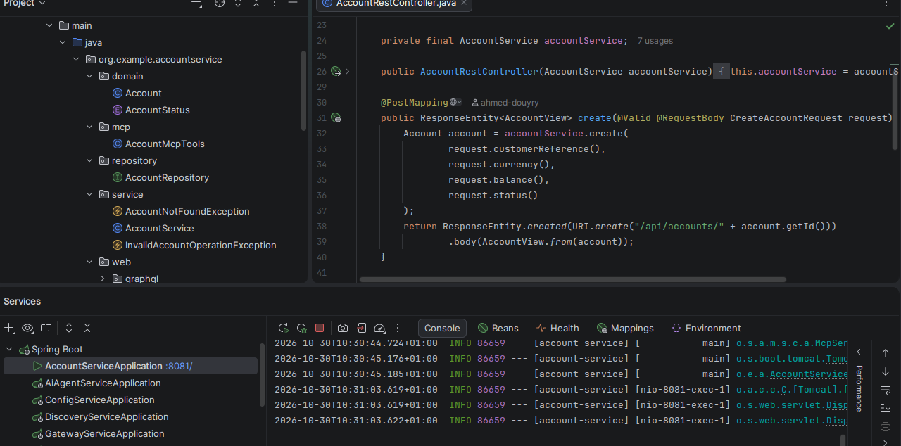

Les méthodes annotées `@McpTool` rendent les opérations bancaires accessibles à l'agent IA. La capture montre les outils de liste, consultation et création de comptes, avec la description de leurs paramètres.

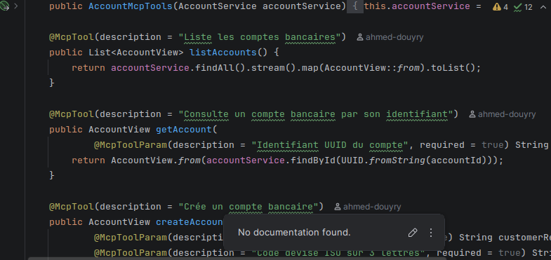

### Consultation REST

La requête `GET http://localhost:8081/api/accounts` retourne les comptes avec leurs identifiants, références client, statuts, devises et soldes.

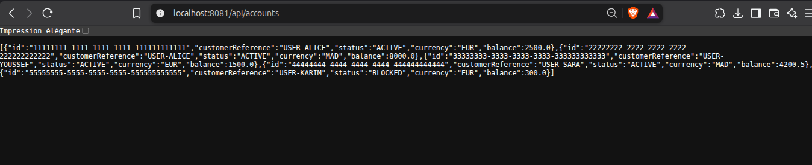

La consultation d'un compte précis montre ici le compte de Karim, au statut `BLOCKED`, avec un solde de `300 EUR`.

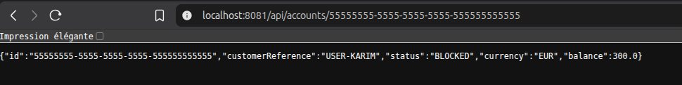

### Service des transactions et gestion des erreurs

Le service des transactions dispose de ses propres couches métier, dépôt, client HTTP et interfaces MCP et GraphQL. L'éditeur affiche ici `GlobalExceptionHandler.java` du service des comptes, avec le traitement des ressources absentes, des opérations invalides et des erreurs de validation ; le panneau d'exécution montre le service des transactions sur le port `8082`.

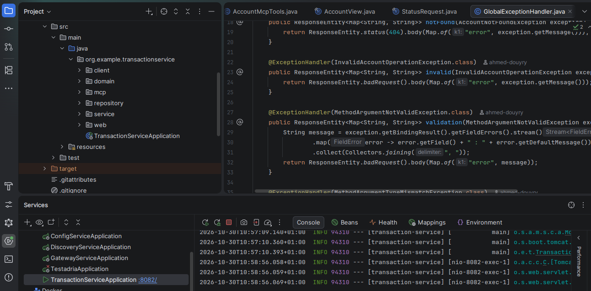

### GraphQL

Les interfaces GraphiQL sont accessibles sur `http://localhost:8081/graphiql` pour les comptes et `http://localhost:8082/graphiql` pour les transactions.

Exemple de requête de consultation :

```graphql
query {
  accounts {
    id
    customerReference
    status
    currency
    balance
  }
}
```

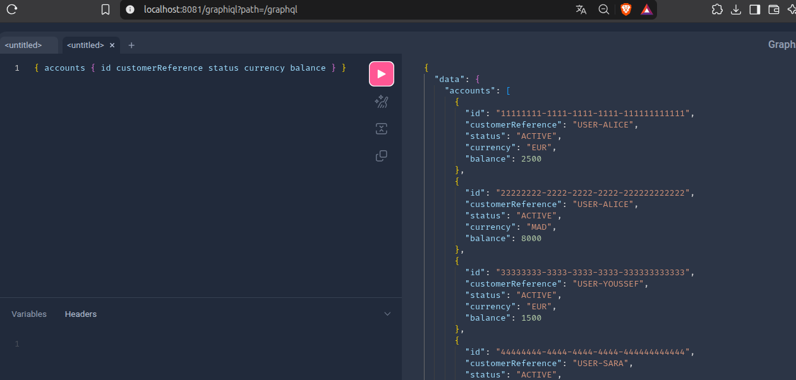

La capture suivante montre une mutation `createTransaction` qui échoue avec le message **« Le service des comptes est indisponible. Réessayez plus tard. »**, une classification `INTERNAL_ERROR` et `data: null`. Elle illustre un cas d'indisponibilité de la dépendance ; la création de la transaction n'est pas validée par cette capture.

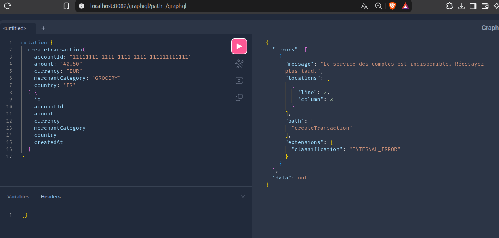

Le code du service des transactions prévoit des délais d'attente, un circuit breaker et des tentatives supplémentaires sur les lectures avec OpenFeign et Resilience4j.

### Principaux points d'entrée via la gateway

Préfixe commun : `http://localhost:9999`.

| Méthode | Chemin | Opération |
| --- | --- | --- |
| `GET`, `POST` | `/account/api/accounts` | Lister ou créer des comptes |
| `GET` | `/account/api/accounts/{id}` | Consulter un compte |
| `PATCH` | `/account/api/accounts/{id}/status` | Changer le statut |
| `POST` | `/account/api/accounts/{id}/credit` | Créditer un compte |
| `POST` | `/account/api/accounts/{id}/debit` | Débiter un compte |
| `GET`, `POST` | `/transaction/api/transactions` | Consulter ou créer des transactions |
| `POST` | `/transaction/api/transfers` | Effectuer un virement |
| `GET` | `/transaction/api/settings` | Lire le plafond d'opération |
| `POST` | `/account/graphql` | Exécuter une opération GraphQL sur les comptes |
| `POST` | `/transaction/graphql` | Exécuter une opération GraphQL sur les transactions |
| `GET`, `POST` | `/agent/chat` | Interroger l'assistant |

## Découverte, configuration et routage

### Annuaire Eureka

La console Eureka affiche ici `ACCOUNT-SERVICE`, `CONFIG-SERVICE`, `GATEWAY-SERVICE` et `TRANSACTION-SERVICE` au statut `UP`. Cette capture montre les services enregistrés au moment de la prise de vue.

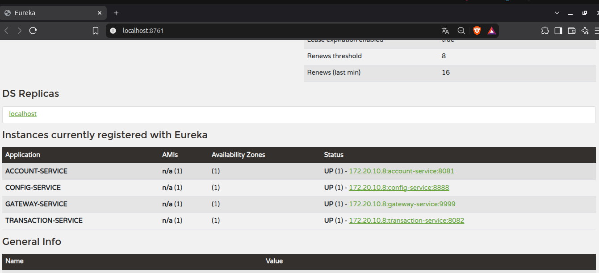

### Configuration centralisée

L'URL `http://localhost:8888/transaction-service/default` expose la configuration du service des transactions. La réponse contient la propriété `bank.transaction.max-amount=1000`, issue de `classpath:/config/application.properties`.

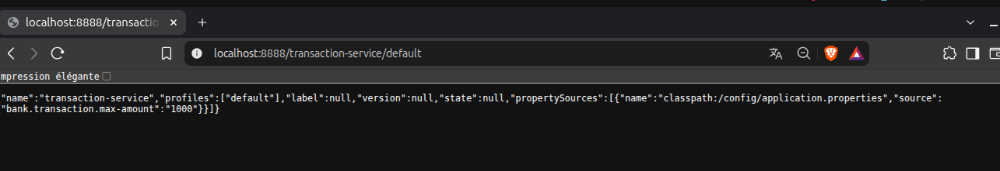

### Gateway

La gateway supprime le premier segment du chemin avant de transmettre la requête au service trouvé dans Eureka. Ainsi, `/account/api/accounts` est transmis au service des comptes sur `/api/accounts`.

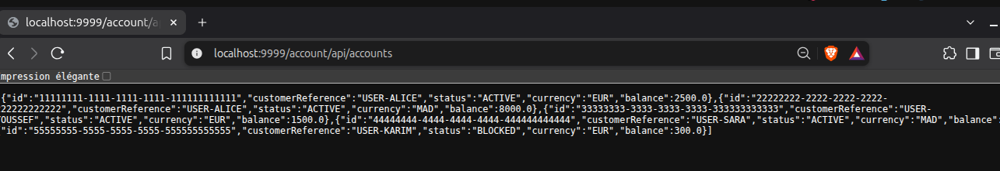

L'URL `/transaction/api/settings` retourne ici le plafond de `1000`, ce qui illustre l'accès aux paramètres métier à travers la gateway.

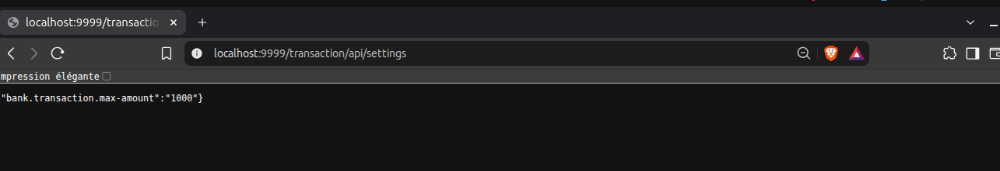

## Assistant IA et Telegram

L'agent utilise les outils MCP des services de comptes et de transactions pour répondre aux demandes. Il est accessible depuis Angular, par HTTP et par le bot Telegram lorsque celui-ci est configuré.

La conversation Telegram montre la commande `/start`, puis une question sur le solde d'Alice. Le bot demande quel compte consulter, car Alice possède un compte EUR et un compte MAD.

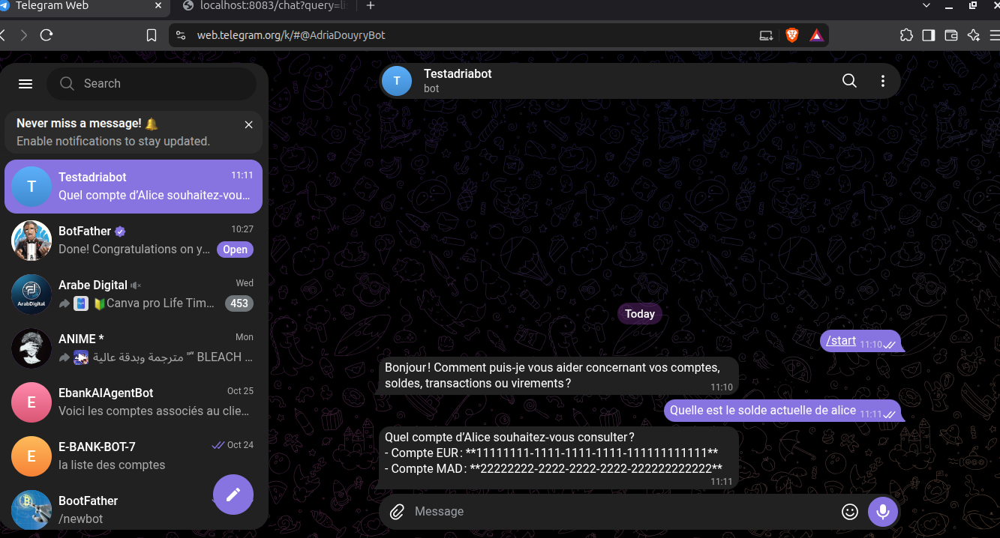

La capture HTTP montre une réponse de l'agent sur `/chat?query=...`, avec une liste des comptes et leurs soldes.

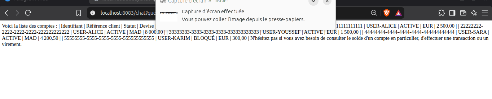

Exemples d'appels :

```bash
curl --get 'http://localhost:9999/agent/chat' \
  --data-urlencode 'query=Liste les comptes'

curl 'http://localhost:9999/agent/chat' \
  -H 'Content-Type: application/json' \
  -d '{"query":"Quel est le solde d’Alice en euros ?","conversationId":"demo"}'
```

Pour activer Telegram, définir `TELEGRAM_BOT_TOKEN` avant de lancer le service ou la pile Docker. Le nom du bot se configure avec `telegram.bot-username` dans les propriétés du service IA.

## Tests et livraison

Depuis la racine, lancer les tests backend :

```bash
./mvnw -B -ntp verify
```

Pour vérifier le client Angular :

```bash
cd frontend-angular
npm ci
npm test -- --watch=false
npx ng build --configuration=production
```

Le workflow [`.github/workflows/ci.yml`](.github/workflows/ci.yml) définit trois étapes :

1. Compilation et tests Java, puis tests et compilation Angular.
2. Construction et publication des sept images sur GitHub Container Registry avec les tags du commit et `latest`.
3. Affichage des commandes de déploiement et de retour à une version précédente. Cette dernière étape est schématique : elle ne contacte aucun serveur ni cluster.

Les captures du document sont conservées dans [`docs/screenshots`](docs/screenshots), à leur résolution d'origine, pour permettre leur affichage directement sur GitHub.
